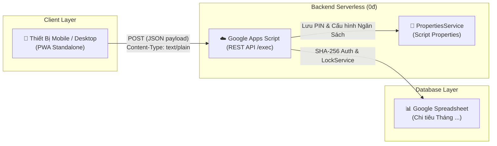

# 💳 FlexMoney — Smart Personal Expense Tracker

<p align="center">
  
</p>

<p align="center">
  <b>Ứng dụng quản lý tài chính cá nhân phong cách Neobank hiện đại, độc lập như Native App (PWA) và đồng bộ trực tiếp 2 chiều với Google Sheets.</b>
</p>

<p align="center">
  <a href="https://nguyennguyenplus-source.github.io/Flexmoney/"></a>
  
  
  
  
</p>

---

## 🌟 Điểm Nổi Bật (Highlights)

- 🎨 **Giao diện Neobank Premium:** Thiết kế tối giản, hiện đại lấy cảm hứng từ các app ngân hàng số thế hệ mới (thẻ Obsidian `#111315`, điểm nhấn Electric Lime `#C7F238`, font chữ tiếng Việt chuẩn **Be Vietnam Pro**, biểu tượng vector sắc nét từ **Lucide Icons** — hoàn toàn không dùng emoji AI-slop).
- 📱 **Trải nghiệm Native App (PWA Chuẩn):** Cài đặt trực tiếp lên màn hình chính trên cả **iOS (iPhone/iPad)** và **Android**. Mở app toàn màn hình (Standalone mode), không vướng thanh địa chỉ hay thanh điều hướng trình duyệt, hỗ trợ Service Worker đệm tài nguyên ngoại tuyến.
- ⚡ **Đồng bộ trực tiếp 2 chiều với Google Sheets:** Dữ liệu thuộc về bạn 100%, lưu trữ trên Google Drive cá nhân. Tự động chèn thêm dòng thông minh khi một ngày phát sinh nhiều hơn 5 giao dịch mà vẫn bảo toàn định dạng số tiền, đường viền, dropdown danh mục và công thức tổng kết của Sheet.
- 🗓️ **Tự động quản lý vòng đời tháng (Auto-lifecycle):** Sang tháng mới, hệ thống tự động nhân bản tab tháng với đúng số ngày thực tế (28–31 ngày), chia màu ngày chẵn/lẻ xen kẽ, tự kết chuyển số dư tiền mặt & tài khoản cuối kỳ trước sang đầu kỳ mới.
- 🎯 **Ngân sách thông minh & Cảnh báo hạn mức:** Đặt hạn mức chi tiêu tổng và từng danh mục (`Ăn uống`, `Nhà ở`, `Đi lại`, `Mua sắm`, `Giải trí`, `Sức khỏe`). Thanh tiến độ trực quan với cảnh báo màu Hổ phách khi đạt 80% và Đỏ khi vượt 100%.
- 📊 **Biểu đồ chi tiêu & So sánh liên tháng (MoM Analytics):** Biểu đồ cột trực quan theo ngày trong tháng, đường trung bình ngày (`TB ...k`), bấm chạm để lọc nhanh giao dịch trong ngày và bảng so sánh biến động chi tiêu với tháng liền trước.
- 🔒 **Bảo mật mã PIN & Kiến trúc Zero-Leak:** Khóa ứng dụng bằng mã PIN băm SHA-256 trên Google Apps Script. Repo GitHub hoàn toàn không lưu thông tin cá nhân hay link Sheet riêng, nhiều người có thể dùng chung 1 web app nhưng dữ liệu hoàn toàn tách biệt.

---

## 🏗️ Kiến Trúc Hệ Thống (Architecture)



### Nguyên Lý Hoạt Động:
1. **Frontend (GitHub Pages):** Ứng dụng PWA thuần tĩnh (HTML5, Vanilla JS, CSS Variables) tải siêu nhanh, lưu trữ trên GitHub Pages miễn phí.
2. **CORS-Friendly REST API:** Gọi tới Google Apps Script endpoint bằng giao thức `POST` với `Content-Type: text/plain;charset=utf-8` để tránh lỗi CORS Preflight (`OPTIONS`).
3. **Database (Google Sheets):** Đọc và ghi dữ liệu chi tiêu có cấu trúc vào các tab tháng chuẩn (`B5:G7` Dashboard số dư, `C11:F16` Thống kê danh mục, `B21:G` Nhật ký chi tiết).

---

## 📂 Cấu Trúc Mã Nguồn (Repository Structure)

```text
Flexmoney/
├── icons/                          # Bộ icon ứng dụng chất lượng cao
│   ├── favicon.png                 # Web favicon
│   ├── apple-touch-icon.png        # Icon dành riêng cho iOS Safari (180x180)
│   ├── icon-192.png                # PWA standard icon (192x192)
│   ├── icon-512.png                # PWA high-res splash icon (512x512)
│   └── icon-maskable-512.png       # Android adaptive / maskable icon
├── index.html                      # Toàn bộ mã nguồn giao diện PWA & Controller JS
├── manifest.json                   # Web App Manifest (standalone, theme-color, icons)
├── sw.js                           # Service Worker xử lý cache ngoại tuyến
└── README.md                       # Tài liệu hướng dẫn sử dụng và triển khai
```

*(Mã nguồn backend Google Apps Script: file `Code.gs` chạy trực tiếp trong trình soạn thảo Apps Script gắn liền với Google Sheet của bạn).*

---

## 🚀 Hướng Dẫn Cài Đặt Nhanh (Setup Guide)

Chỉ mất khoảng **3–5 phút** để triển khai hoàn chỉnh một hệ thống FlexMoney cho riêng bạn:

### Bước 1: Chuẩn bị Google Sheet & Apps Script
1. Mở hoặc tạo một bản sao Google Sheet quản lý chi tiêu cá nhân trên Google Drive của bạn.
2. Trên thanh menu của Google Sheet, chọn **Tiện ích mở rộng (Extensions)** → **Apps Script**.
3. Dán toàn bộ mã nguồn backend `Code.gs` vào trình chỉnh sửa.
4. Nhấn **Lưu (`Ctrl + S`)**.
5. Nhìn thanh công cụ phía trên, chọn hàm `getAppState` rồi bấm **Chạy (Run)** để cấp quyền truy cập Google Drive/Spreadsheet lần đầu.

### Bước 2: Triển khai Web App (Deploy REST API)
1. Ở góc trên bên phải của trang Apps Script, bấm **Triển khai (Deploy)** → **Tùy chọn triển khai mới (New deployment)**.
2. Nhấn biểu tượng bánh răng ⚙️ ở mục *Chọn loại* → chọn **Ứng dụng web (Web app)**.
3. Thiết lập thông số:
   - **Mô tả:** `FlexMoney API v1`
   - **Thực thi dưới tên:** `Tôi (email của bạn)`
   - **Ai có quyền truy cập:** `Bất kỳ ai (Anyone)` *(Được bảo vệ bởi mã PIN băm SHA-256)*.
4. Bấm **Triển khai (Deploy)** và **Sao chép đường dẫn Web App** (URL kết thúc bằng `/exec`).

### Bước 3: Kết nối & Cài đặt PWA trên Điện Thoại
1. Mở trang Web App trên điện thoại:
   ```text
   https://nguyennguyenplus-source.github.io/Flexmoney/
   ```
2. Dán đường link `/exec` vừa sao chép ở Bước 2 vào khung kết nối → bấm **Kiểm tra & Lưu kết nối**.
3. Cài đặt App ra màn hình chính:
   - **Trên iPhone (Safari):** Bấm biểu tượng **Chia sẻ** *(hình vuông có mũi tên lên)* → chọn **Thêm vào MH chính (Add to Home Screen)**.
   - **Trên Android (Chrome/Brave):** Bấm biểu tượng **3 chấm** góc phải → chọn **Cài đặt ứng dụng** hoặc **Thêm vào màn hình chính**.
4. Mở icon **FlexMoney** từ màn hình chính, vào mục **Cài đặt ⚙️** → **Mã PIN khóa ứng dụng** để đặt mã PIN 6 số bảo vệ ví tiền của bạn.

---

## 👥 Sử Dụng Chung Nhiều Người (Multi-User Privacy)

FlexMoney được thiết kế theo tư duy **Zero-Knowledge Frontend**:
- Mã nguồn trên GitHub Pages hoàn toàn **không lưu cứng đường link API hay Sheet của bất kỳ ai**.
- Bạn bè hoặc người thân của bạn có thể sử dụng chung đường link GitHub Pages này. Mỗi người chỉ cần tạo 1 bản sao Google Sheet riêng, lấy link `/exec` riêng và dán vào máy của mình.
- Dữ liệu lưu cục bộ trong `localStorage` của từng thiết bị, đảm bảo tính riêng tư tuyệt đối 100%.

---

## 🛠️ Danh Sách API Backend (Apps Script Dispatcher)

Backend xử lý toàn bộ các hành động thông qua `doPost(e)`:

| Action | Mô Tả |
| :--- | :--- |
| `getAppState` | Lấy số dư tức thời, danh mục, giao dịch ngày chọn, ngân sách & so sánh tháng trước |
| `addTransaction` | Thêm khoản chi/thu mới (tự chèn thêm hàng thông minh nếu ngày vượt quá 5 mục) |
| `updateTransaction` | Cập nhật thông tin/số tiền của giao dịch hiện có theo dòng |
| `deleteTransaction` | Xóa giao dịch (dọn sạch dữ liệu, giữ nguyên cấu trúc dòng và định dạng) |
| `updateInitialBalances` | Điều chỉnh số dư tiền mặt và tài khoản ban đầu đầu tháng |
| `createMonthSheet` | Khởi tạo bảng chi tiêu tháng mới (tự chia 28–31 ngày, kết chuyển số dư) |
| `updateAutoCreateSettings` | Bật/tắt tự động tạo tab mới khi sang tháng và tùy chọn mang số dư sang |
| `saveBudgets` | Lưu hạn mức chi tiêu tổng và hạn mức chi tiết cho từng danh mục |
| `verifyPin` / `updatePinSettings` | Xác thực mã PIN và cập nhật/xóa mã PIN băm SHA-256 |

---

## 🗺️ Lộ Trình Phát Triển (Roadmap)

- [x] Giao diện Neobank chuẩn PWA, cài đặt không thanh địa chỉ trên iOS & Android.
- [x] Tự động chèn dòng khi ngày > 5 mục, bảo toàn công thức và định dạng.
- [x] Tự động tạo tab tháng mới và kết chuyển số dư.
- [x] Đặt ngân sách tháng & cảnh báo màu Hổ phách (80%) / Đỏ (100%).
- [x] Biểu đồ chi tiêu theo ngày & so sánh biến động liên tháng (MoM).
- [ ] **AI Receipt Scanner:** Tích hợp Gemini 2.5 Flash chụp ảnh hóa đơn/bill chuyển khoản, tự động trích xuất số tiền, nội dung và danh mục vào form trong 1 giây.
- [ ] **Khoảnh khắc chi tiêu (Locket Style):** Đính kèm ảnh chụp bữa ăn / món đồ trực tiếp vào Google Drive cá nhân, xem lại feed ảnh kỷ niệm chi tiêu.
- [ ] **Ví đôi / Quỹ chung (Couple Mode):** Chế độ chuyển đổi nhanh giữa ví cá nhân và quỹ chi tiêu chung của 2 người.

---

## 📄 Bản Quyền (License)

Dự án phát hành dưới giấy phép mã nguồn mở [MIT License](https://opensource.org/licenses/MIT). Bạn hoàn toàn có quyền sử dụng, tùy biến và chia sẻ cho mục đích cá nhân hoặc cộng đồng.

---

<p align="center">
  Phát triển với ❤️ và sự tinh tế dành cho tài chính cá nhân thông minh.
</p>
